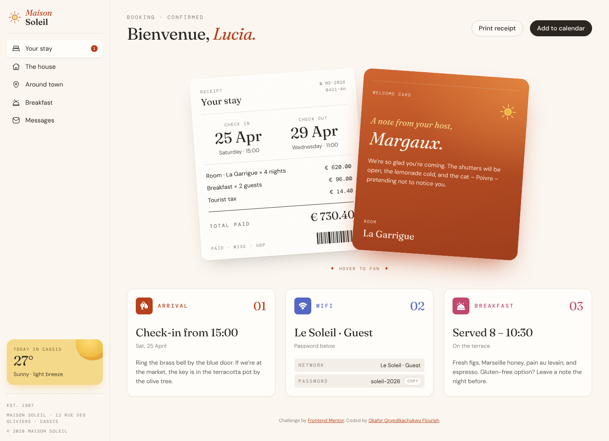

# Frontend Mentor - Hotel booking confirmation page solution

This is a solution to the [Hotel booking confirmation page challenge on Frontend Mentor](https://www.frontendmentor.io/challenges/hotel-booking-confirmation-page). Frontend Mentor challenges help you improve your coding skills by building realistic projects.

## Table of contents

- [Overview](#overview)
  - [The challenge](#the-challenge)
  - [Screenshot](#screenshot)
  - [Links](#links)
- [My process](#my-process)
  - [Built with](#built-with)
  - [Project structure](#project-structure)
  - [What I learned](#what-i-learned)
  - [Continued development](#continued-development)
  - [Useful resources](#useful-resources)
  - [AI Collaboration](#ai-collaboration)
- [Author](#author)

## Overview

### The challenge

Users should be able to:

- [x] View the optimal layout for the interface depending on their device's screen size
- [x] See hover and focus states for all interactive elements on the page
- [x] Open and close the navigation menu on smaller screens
- [x] Copy the Wi-Fi password to their clipboard using the copy button

Extras from "Ideas to test yourself":

- [x] Receipt and host-note cards fan out on hover, with the sun illustration appearing between them
- [x] "Print receipt" opens a clean print view that shows only the receipt
- [x] "Add to calendar" downloads an `.ics` file built from the stay dates

Extra pages (my own addition, in the same design language):

- **The house**: the story of the house, room details and house rules
- **Around town**: places in Cassis with filter buttons (Beaches, Walks, Food & market, Day trips)
- **Breakfast**: the menu plus a "note for tomorrow" form with validation, saved in `localStorage`
- **Messages**: a chat with the host, quick replies and a working composer (saved in `localStorage`, demo only)

### Screenshot



### Links

- Solution URL: [github.com/okafor-onyedikachukwu-flourish/HotelBookingConfirmation](https://github.com/okafor-onyedikachukwu-flourish/HotelBookingConfirmation)
- Live Site URL: [hotelbookingconfirmation.vercel.app](https://hotelbookingconfirmation.vercel.app)

## My process

### Built with

- Semantic HTML5 markup (`aside`, `nav`, `main`, `article`, `dl`, `time`, `address`)
- CSS custom properties (design tokens for colours, fonts, radii)
- Flexbox and CSS Grid
- Mobile-first workflow with two breakpoints: `40rem` (cards side by side) and `64rem` (sidebar layout)
- Vanilla JavaScript (no frameworks)
- Self-hosted fonts: Fraunces, DM Sans, DM Mono (SIL Open Font License)

### Project structure

```
index.html         Your stay (the challenge page)
house.html         The house
around-town.html   Around town
breakfast.html     Breakfast
messages.html      Messages
style.css          one stylesheet for every page
script.js          one script for every page
assets/
  fonts/    Fraunces, DM Sans, DM Mono (.woff2)
  images/   logo, icons, illustrations, favicon
```

Every page shares the same sidebar. `script.js` checks whether each feature's elements exist before running it, so one file works safely on all five pages.

### What I learned

**Changing visual order without changing the HTML.** On mobile the host note appears above the receipt, but in the HTML the receipt comes first. Flexbox `order` handles that:

```css
.host-note {
  order: -1; /* show first on mobile */
}
```

**Hover effects only where hover exists.** The fan-out animation is wrapped in a media query so touch screens don't get a "stuck" hover state:

```css
@media (min-width: 40rem) and (hover: hover) {
  .stage:hover .receipt   { transform: translateX(-4.5rem) rotate(3deg); }
  .stage:hover .host-note { transform: translateX(4.5rem) rotate(-3deg); }
}
```

**An accessible menu button.** The toggle uses `aria-expanded` and `aria-controls`, and CSS reads `aria-expanded` to swap the hamburger and close icons. Pressing Escape closes the menu and returns focus to the button.

**Reading data from the HTML in JavaScript.** The calendar file uses the `<time datetime="...">` values from the receipt, so the dates only live in one place:

```js
const checkIn = new Date(document.querySelector("[data-check-in]").dateTime);
```

**Fluid sizes instead of breakpoint jumps.** Page padding, the space above the cards and the big headings use `clamp()`. They match the design at 375px and 1440px and grow smoothly in between:

```css
--gutter: clamp(1rem, 0.13328rem + 3.698vw, 2.5rem); /* 1rem at 375px, 2.5rem from 1024px */
```

**Logical properties.** The stylesheet uses `margin-block-start`, `padding-inline`, `inline-size` and so on instead of `margin-top`, `padding-left`, `width`. They look identical in English, but the layout would flip correctly for right-to-left languages.

**Design tokens.** Every colour, font size and spacing value comes from a custom property (`--fs-14`, `--space-16`, `--terracotta-600`). Transparent shades are made with `color-mix()` from the same tokens:

```css
box-shadow: 0 30px 60px -24px color-mix(in srgb, var(--terracotta-600) 75%, transparent);
```

### Continued development

- Load the booking details from a JSON file instead of hardcoding them
- Add real pages for "The house", "Around town", "Breakfast" and "Messages"

### Useful resources

- [MDN: Clipboard API](https://developer.mozilla.org/en-US/docs/Web/API/Clipboard_API) – how `navigator.clipboard.writeText()` works
- [MDN: @media hover](https://developer.mozilla.org/en-US/docs/Web/CSS/@media/hover) – detecting devices that can hover
- [MDN: Printing](https://developer.mozilla.org/en-US/docs/Web/CSS/CSS_media_queries/Printing) – print stylesheets

### AI Collaboration

- Planned and built with Claude (Anthropic).
- Claude matched the layout and colours to the design JPGs, wrote the HTML, CSS and JavaScript, and tested them at desktop, tablet and mobile sizes.

## Author

- GitHub - [Okafor Onyedikachukwu Flourish](https://github.com/okafor-onyedikachukwu-flourish)
- Frontend Mentor - [@yourusername](https://www.frontendmentor.io/profile/yourusername)
